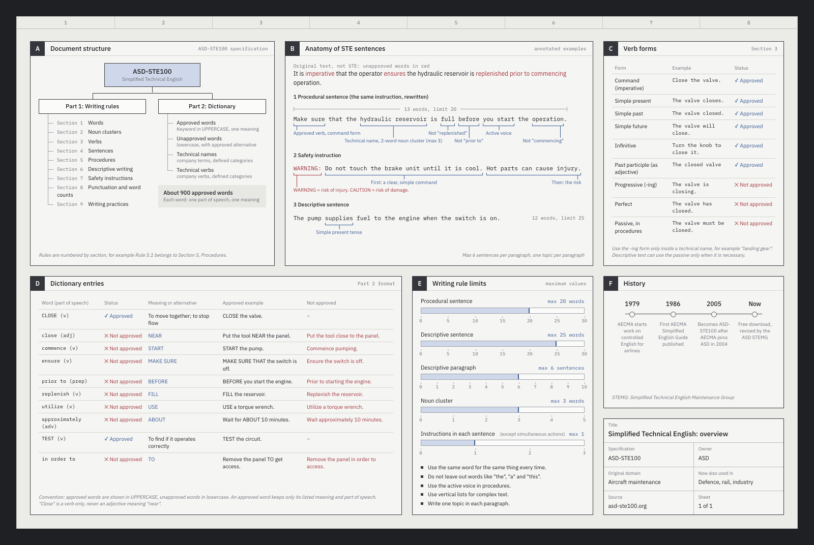

# karpathy-workflow

This Claude Code skill makes Claude work the way Andrej Karpathy describes working with it. You give short, plain-English instructions. Claude builds the thing, runs it, checks it, and reports back with evidence you can look at. When you ask it to explain something, it draws an explainer sheet like this one:



It is built from two sources:
- The four coding guidelines in [multica-ai/andrej-karpathy-skills](https://github.com/multica-ai/andrej-karpathy-skills): think before coding, simplicity first, surgical changes, and goal-driven execution.
- [Karpathy's HackerTube post](https://karpathy.bearblog.dev/hacker-tube/) and the habits covered in [Nick Saraev's video](https://youtu.be/3wCkFtIz88g).

## Install

**As a plugin** (recommended). Run this in Claude Code:

```
/plugin install karpathy-workflow --marketplace Anishpras/karpathy-coding-skill
```

On older versions of Claude Code, add the marketplace first, then install:

```
/plugin marketplace add Anishpras/karpathy-coding-skill
/plugin install karpathy-workflow@karpathy-coding-skill
```

**By hand.** Clone the repo and link the skill into your user skills folder. If you've set a custom config dir, use `$CLAUDE_CONFIG_DIR/skills` instead of `~/.claude/skills`.

```bash
git clone https://github.com/Anishpras/karpathy-coding-skill.git
ln -s "$(pwd)/karpathy-coding-skill/karpathy-workflow" ~/.claude/skills/karpathy-workflow
```

Claude loads the skill on its own for coding tasks and explain requests. You can also call it with `/karpathy-workflow`.

**Requirements for explainer sheets:** Node 22 or newer, and Google Chrome or Chromium. If Chrome isn't in a standard place, set `CHROME_PATH`. There are no npm dependencies.

## What it does

1. Turns a short prompt into a goal with a check it can run.
2. States its assumptions instead of guessing silently, and asks first before anything expensive or hard to undo.
3. Builds the smallest thing that works, and changes only what you asked for.
4. Runs and checks the work itself, then shows you evidence: a screenshot, a plot, numbers, or command output.
5. Hands you only the steps that need a human, such as API keys, payments, or domains.
6. Reports in plain English.

It also covers explaining things with pictures, handling big datasets (cheap code filters first, then a cheaper model for labeling), and sharing a project's data instead of its app.

## Explainer sheets

When you ask Claude to explain something, it draws a one-page PNG with lettered panels: diagrams, charts, tables, and annotated examples. Claude writes only the content. `render.mjs` adds the style, saves a self-contained `.html` and a `.png`, and fails the render if:
- text overlaps, spills out of a panel, or gets cut off
- a chart has bad data
- the page has a JavaScript error

It also warns about half-empty panels and leftover placeholder text. Claude then looks at the PNG before it sends you the path.

To try the renderer on an example:

```bash
node karpathy-workflow/scripts/render.mjs karpathy-workflow/assets/examples/hackertube.src.html /tmp/hackertube
open /tmp/hackertube.png
```

## What's in it

```
karpathy-workflow/
├── SKILL.md                    the workflow (loads when the skill triggers)
├── references/
│   ├── visual-explainers.md    how to build a sheet: panels, components, chart rules
│   ├── explaining.md           plain-English (ASD-STE100 style) writing rules
│   ├── data-pipelines.md       recipe: cheap code filters, then cheaper-model labeling
│   └── sources.md              where each idea comes from, first-hand or reported
├── scripts/
│   └── render.mjs              fragment → self-contained .html + .png, with layout checks
└── assets/
    ├── sheet.css, sheet.js     the technical-drawing style and the chart code
    ├── fonts/                  IBM Plex Sans and Mono
    └── examples/               example sheets (.src.html fragment + .png)
```

## Your side of the workflow

The skill covers Claude's half. These are Karpathy's habits for the human half:

- **Setup:** he uses the Claude Code desktop app with Opus at medium effort. He finds medium enough for quick back-and-forth work.
- **Short prompts:** say what you want, not how to do it. Extra requirements can conflict and make the result worse.
- **Judge results, not code:** ask for a screenshot, a plot, or numbers.
- **Don't trust leaderboards:** compare models on your own task with a small test you can see at a glance.
- **Fix what annoys you:** a personal replacement for a bad tool or feed can now be an afternoon's work. HackerTube took about two hours.
- **Share the data:** when you share a project, share the data and the prompt, not the code.

## License

MIT; see [LICENSE](LICENSE). The bundled IBM Plex fonts are under the SIL Open Font License 1.1; see [OFL.txt](karpathy-workflow/assets/fonts/OFL.txt). Some details about Karpathy's habits come from secondary reports. [sources.md](karpathy-workflow/references/sources.md) marks which ones.
